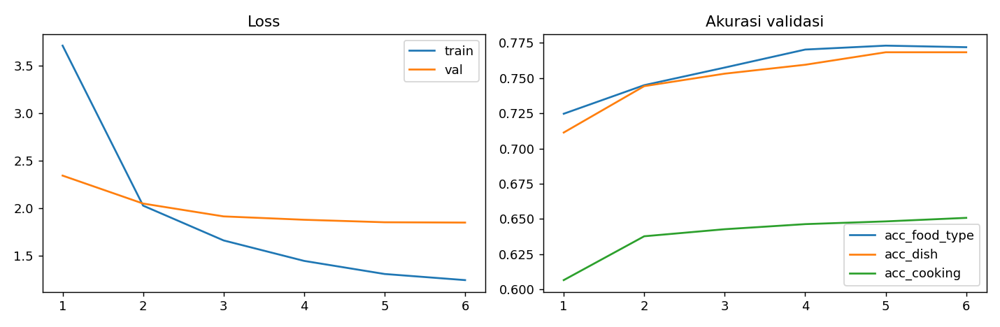
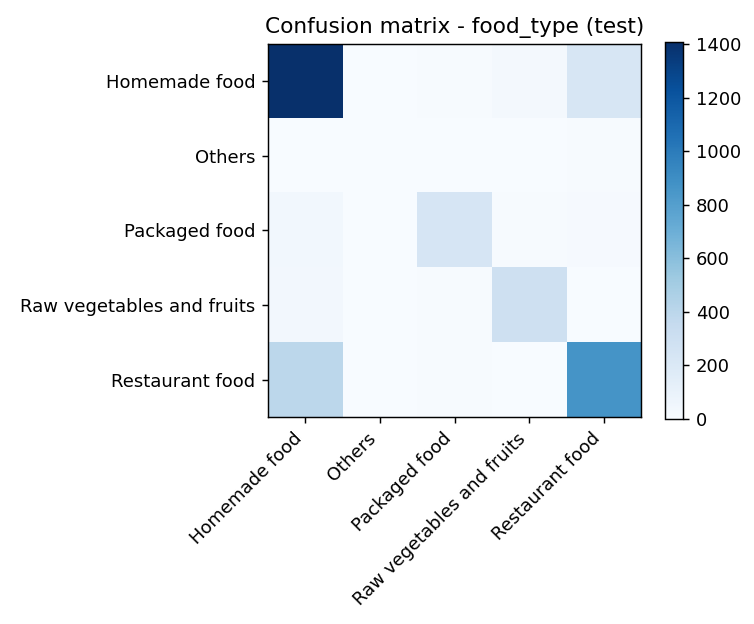

# ConvNeXt-Tiny - MMFood Multihead

Eksperimen pemahaman foto makanan dengan satu backbone ConvNeXt-Tiny dan empat head: jenis makanan, nama hidangan, metode memasak, serta estimasi kalori, protein, lemak dan karbohidrat.

[English](README.md) | [Panduan mencoba](docs/usage.id.md) | [Hasil dan analisis](docs/results.md) | [Dokumentasi](docs/README.md)

## Isi proyek

- Sembilan notebook dari konfigurasi dan eksplorasi data sampai ekspor model, lengkap dengan output proses asli.
- Tiga head klasifikasi: 5 jenis/konteks makanan, 50 nama hidangan dan 11 metode memasak.
- Satu head regresi empat nilai nutrisi, dengan transformasi log1p dan standardisasi statistik train.
- Grafik distribusi, kurva pelatihan, confusion matrix, metrik JSON dan audit duplikasi gambar.
- Model safetensors yang dapat dicoba di CPU tanpa menjalankan training.

## Unduh dan coba

**[Model dan file lengkap di Hugging Face](https://huggingface.co/muhammadrafifatihulihsan/convnext-tiny-mmfood-multihead)**

Bobot utama sekitar 112,3 MB. GitHub menyimpan kode, notebook dan laporan; bobot berada di Hugging Face. Dataset, cache gambar dan checkpoint optimizer tidak dibagikan.

```python
from huggingface_hub import snapshot_download
snapshot_download(
    repo_id="muhammadrafifatihulihsan/convnext-tiny-mmfood-multihead",
    local_dir="models/convnext-tiny-mmfood-multihead",
)
```

Ikuti [panduan penggunaan](docs/usage.id.md) untuk membuat environment dan menjalankan contoh satu gambar. Tidak perlu dataset atau GPU untuk uji inferensi.

## Hasil tersimpan

| Tugas | Hasil test | Cakupan |
| --- | ---: | --- |
| Jenis makanan | 77,92% akurasi | 3.600 gambar |
| Nama hidangan | 79,21% akurasi | 856 gambar berlabel top-50 |
| Metode memasak | 65,50% akurasi | 3.600 gambar |
| Kalori | MAE 95,68 kkal | Baseline 190,06 kkal |
| Protein | MAE 6,28 g | Baseline 14,08 g |
| Lemak | MAE 5,23 g | Baseline 10,56 g |
| Karbohidrat | MAE 13,26 g | Baseline 23,47 g |



**Hasil ini bukan benchmark bebas kebocoran.** Audit menemukan 281 gambar test (7,81%) identik dengan train, sehingga metrik dapat terlalu optimistis. Akurasi hidangan hanya berlaku pada subset yang memiliki label top-50. Baseline nutrisi adalah rata-rata di ruang log1p yang dikembalikan ke satuan asli, bukan rata-rata aritmetika biasa. [Baca analisis lengkap](docs/results.md).

## Alur dan batas model

100.000 baris metadata dibersihkan menjadi 99.949 baris. Sebanyak 36.000 URL dicoba dan 35.998 gambar berhasil masuk eksperimen. Split berisi 28.798 train, 3.600 validation dan 3.600 test, dengan enam epoch tercatat.

```text
Foto -> resize/crop -> ConvNeXt-Tiny -> jenis makanan
                                   -> nama hidangan
                                   -> metode memasak
                                   -> empat nilai nutrisi
```

Processor ekspor berbeda dari transformasi evaluasi notebook. Contoh inferensi memakai resize 255 bilinear dan crop tengah 224 agar mengikuti evaluasi historis. Skor softmax bukan kepastian terkalibrasi; hidangan tidak dikenal tetap dipilihkan dari 50 kelas. Estimasi nutrisi tidak mengukur porsi dan tidak ditujukan untuk keputusan kesehatan.



## Navigasi

| Dokumen | Isi |
| --- | --- |
| [Panduan mencoba](docs/usage.id.md) | Unduhan, instalasi dan prediksi gambar |
| [Arsitektur](docs/project.md) | Empat head, loss dan struktur modul |
| [Dataset](docs/data.md) | Pembersihan, label, pembagian dan ketimpangan kelas |
| [Hasil](docs/results.md) | Metrik, baseline dan duplikasi antar-split |
| [Training](docs/training.md) | Notebook 00?08 dan parameter eksperimen |
| [Troubleshooting](docs/troubleshooting.md) | Masalah environment, autentikasi dan model |
| [Validasi](VALIDATION.md) | Pengujian yang dilakukan beserta batasnya |

Kode, bobot dan seluruh output notebook dipertahankan. Hanya evaluasi pribadi nonkomersial yang diizinkan atas karya penulis; tidak ada izin modifikasi, fine-tuning, redistribusi atau integrasi produk. Hak dataset/backbone tetap mengikuti pemiliknya. Lihat [ketentuan](LICENSE.md) dan [atribusi](THIRD_PARTY_NOTICES.md).
