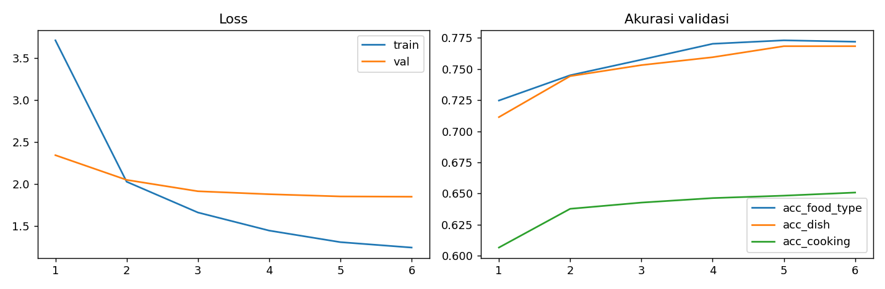
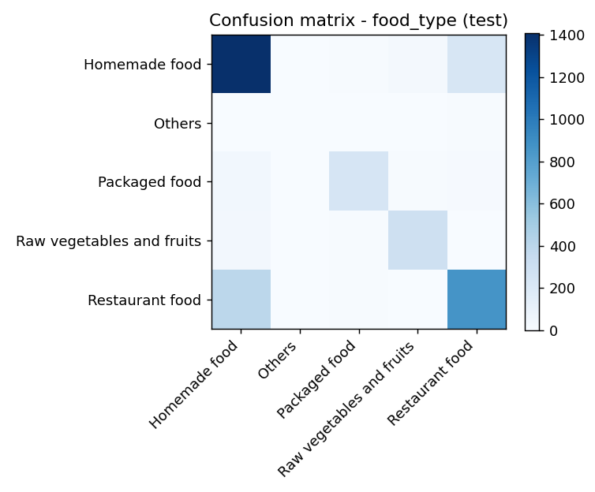

# ConvNeXt-Tiny - MMFood Multihead

[English](README.md) | [Bahasa Indonesia](README.id.md)

<a id="overview"></a>

## Overview

An image-only food-understanding experiment: one ConvNeXt-Tiny backbone predicts food type, dish name, cooking method and four nutrition values. The workflow covers dataset exploration, training, evaluation and model export. Nine original notebooks retain their executed outputs.

[GitHub: source and notebooks](https://github.com/muhammadrafifatihulihsan/convnext-tiny-mmfood-multihead) | [Hugging Face: model files](https://huggingface.co/muhammadrafifatihulihsan/convnext-tiny-mmfood-multihead)

| Property | Value |
| --- | --- |
| Backbone | facebook/convnext-tiny-224 |
| Input | RGB food image, 224 x 224 after preprocessing |
| Food type / dish / cooking classes | 5 / 50 / 11 |
| Nutrition | Calories (kcal), protein, fat, carbohydrate (g) |
| Training subset | 28,798 train / 3,600 validation / 3,600 test |
| Recorded epochs | 6 |
| Main weights | model.safetensors, 112.3 MB (107.1 MiB) |
| Model loading | AutoModel with reviewed custom code |
| Permission | Personal non-commercial evaluation of author contributions |

This is an experimental model, not a production nutrition service, medical device or calibrated portion-measurement system. Public access does not make the author's contributions open source.

<a id="download"></a>

## Download the model

Download the full inference package, including weights, configuration, labels and custom model code. No training run, dataset or GPU is required to try CPU inference.

```python
from huggingface_hub import snapshot_download
folder = snapshot_download(
    repo_id="muhammadrafifatihulihsan/convnext-tiny-mmfood-multihead",
    local_dir="models/convnext-tiny-mmfood-multihead",
    ignore_patterns=["raw/**"],
)
print(folder)
```

The existing Hub raw/ archive contains another historical checkpoint of about 112.4 MB. The example excludes it because safetensors inference does not need it. Omit ignore_patterns only if you want that archive too. Reports and code add to the main weight size. A GitHub ZIP does not include model weights.

Pin revision to a commit SHA from the Hub's Files and versions page for reproducible downloads. Public downloads do not require a token. See [the usage guide](docs/usage.md) for environment setup and offline loading.

<a id="inference"></a>

## Run one image

The tested environment is Python 3.10 on Windows, using CPU inference. Create a virtual environment, activate it, then install the recorded working versions:

```bash
python -m venv .venv
```

Activate with `.venv\Scripts\Activate.ps1` in PowerShell, `source .venv/bin/activate` on Linux/macOS, or `source .venv/Scripts/activate` in Windows Git Bash.

```bash
python -m pip install torch==2.14.1 torchvision==0.29.2 transformers==5.20.2 safetensors==0.8.0 pillow==12.3.0 huggingface_hub==2.4.0
```

After downloading, save this as predict_food.py beside food.jpg and run `python predict_food.py`:

```python
import json
import torch
from PIL import Image
from torchvision import transforms as T
from transformers import AutoModel

folder = "models/convnext-tiny-mmfood-multihead"
model = AutoModel.from_pretrained(
    folder, trust_remote_code=True, local_files_only=True
).eval()
transform = T.Compose([
    T.Resize(255), T.CenterCrop(224), T.ToTensor(),
    T.Normalize([0.485, 0.456, 0.406], [0.229, 0.224, 0.225]),
])
with Image.open("food.jpg") as image:
    pixels = transform(image.convert("RGB")).unsqueeze(0)
with torch.no_grad():
    prediction = model.predict(pixels, topk=3)[0]
print(json.dumps(prediction, indent=2))
```

Review modeling_mmfood.py before enabling trust_remote_code. This custom model does not promise compatibility with the generic image-classification pipeline. The pinned versions record one tested environment, not every OS/GPU combination.

The example follows historical bilinear Resize(255), CenterCrop(224) and ImageNet normalization. The retained exported processor uses bicubic sampling and crop_pct=0.875, so it is not substituted silently. Historical metrics cannot be assumed equal across those paths.

<a id="outputs"></a>

## Understand the outputs

| Key | Meaning |
| --- | --- |
| food_type | Top-k label/softmax-score pairs for food context |
| dish_name | Top-k pairs from the fixed dish vocabulary |
| cooking_method | Top-k pairs for normalized cooking labels |
| nutrition | calories_kcal, protein_g, fat_g, carbohydrate_g |

predict() returns one dictionary per image. Use positive topk, normally 1-3; each head caps it at its class count. Nutrition is decoded from standardized log1p space, clipped nonnegative and rounded to one decimal. It is not explicitly per 100 g. Low-level nutrition_pred is still standardized log space.

Softmax scores are not calibrated certainty. Unknown dishes are not rejected: predictions always choose known labels. For CUDA, move model and input to the same device. No latency or memory benchmark is claimed.

<a id="results"></a>

## Recorded results

| Task | Test result | Coverage / baseline |
| --- | ---: | --- |
| Food type | 77.92% accuracy | 3,600 images |
| Dish | 79.21% accuracy | 856 top-50-labeled images |
| Cooking | 65.50% accuracy | 3,600 images |
| Calories | 95.68 kcal MAE | Baseline 190.06 kcal |
| Protein | 6.28 g MAE | Baseline 14.08 g |
| Fat | 5.23 g MAE | Baseline 10.56 g |
| Carbohydrate | 13.26 g MAE | Baseline 23.47 g |



These are saved metrics, not a new evaluation. Dish accuracy covers only 23.78% of test examples. Nutrition baseline is expm1(mean(log1p(train targets))), not the arithmetic mean in original units.

Exact-byte auditing found 431 groups spanning splits, involving 1,715 images. Of the test images, 281 match training images (7.81%); validation has 263 training matches (7.31%). This may inflate scores. No leakage-corrected benchmark is claimed.



See [complete results and analysis](docs/results.md) and [audit JSON](reports/metrics/publication_audit.json).

<a id="interpretation"></a>

## Why performance is limited

The model beats constant train-majority predictions: 46.58% food type, 10.05% dish on eligible images and 18.28% cooking. This shows learned signal on this split, not reliable generalization to independent photographs.

Food origin and cooking method can be visually ambiguous. Dish coverage is restricted; minority classes have little supervision. Nutrition depends on portions and hidden ingredients not measured by the image. Source labels include model-assisted estimates rather than laboratory measurements.

Cropping may remove meal information while retaining full-image nutrition targets. Shared features may help or compete across tasks. These are plausible mechanisms, not isolated causes demonstrated by ablations. Six epochs or a small backbone cannot be blamed without comparisons.

MAE 95.68 kcal is average absolute error against annotations, not maximum error or percentage accuracy. Leakage may make scores too optimistic, not explain low scores. Processor mismatch affects inference-path comparisons, not the already-recorded notebook evaluation. Prioritize independent splits, consistent preprocessing and per-class/error analysis before claiming benefits from a larger model or longer training. See [the detailed explanation](docs/results.md).

<a id="architecture"></a>

## Architecture

```text
RGB image -> preprocessing -> ConvNeXt-Tiny -> pooled features (768)
                                         -> food_type_head
                                         -> dish_head
                                         -> cooking_head
                                         -> nutrition_head -> inverse log transform
```

Three linear classification heads share the encoder; the nutrition MLP uses 768 -> 256 -> 4 with GELU and dropout. Head dropout is 0.2. Classification uses cross entropy, with dish label -100 ignored; nutrition uses Smooth L1. Combined loss is food + dish + 0.5 * cooking + nutrition.

Nutrition targets are z = (log1p(y) - mean_train) / std_train. Prediction uses expm1(clamp(z * std_train + mean_train, max=9)), then clips to nonnegative values. These are implementation choices, not physiological guarantees. [Architecture and modules](docs/project.md).

<a id="data-training"></a>

## Data and recorded training

The source has 100,000 metadata rows; cleaning retains 99,949. Of 36,000 attempted downloads, 35,998 enter the experiment. Splitting is stratified by food type with seed 42. Dish vocabulary uses top-50 frequencies from the full cleaned data before splitting. Cooking labels use ordered keyword rules and train-frequency merging. Nutrition normalization uses train statistics only; ingredient and portion columns are not inputs.

| Setting | Value |
| --- | --- |
| Batch / epochs | 64 / 6 |
| Backbone / head learning rate | 5e-5 / 1e-3 |
| Optimizer / weight decay | AdamW / 0.05 |
| Schedule | 5% linear warmup then cosine |
| Gradient clipping | Maximum norm 1.0 |
| Best checkpoint | Lowest validation loss |

The Others class has only 77 train and 10 test images. Image cache longest side is 256; training uses random crops, flips and color jitter. CUDA training uses float16 autocast and GradScaler. Resume omits scaler/RNG state. The full experiment has not been rerun during documentation work. [Data preparation](docs/data.md) and [training provenance](docs/training.md).

<a id="notebooks"></a>

## Explore the notebooks

```text
00 Setup -> 01 EDA -> 02 Image cache -> 03 Splits and labels
         -> 04 Training -> 05 Evaluation -> 06 Export
         -> 07 Hub publication -> 08 Results packaging
```

[Read the nine executed notebooks on GitHub](https://github.com/muhammadrafifatihulihsan/convnext-tiny-mmfood-multihead/tree/main/notebooks). Original source, weights and notebook output bytes are preserved. Historical internal Colab paths use mmfood-multitask, while public repositories use convnext-tiny-mmfood-multihead. The [training guide](docs/training.md) explains bootstrap dependencies and original upload behavior.

Reading outputs does not require running training. The evaluation-only permission does not authorize modification or fine-tuning.

<a id="files"></a>

## Where files live

| Location | Contents |
| --- | --- |
| GitHub: src/, notebooks/, artifacts/ | Source, executed workflow and saved experiment settings |
| Hugging Face: model.safetensors | Inference weights |
| Hugging Face: config.json, modeling_mmfood.py | Backbone/head config, AutoClass mapping and custom implementation |
| Hugging Face: labels.json, preprocessor_config.json | Label/statistics mapping and original exported processor |
| Hugging Face: raw/ | Retained historical archive, optional for downloads |
| Both: docs/, reports/, licenses/ | Guides, metrics, audit, figures and upstream license |
| Both: VALIDATION.md, SHA256SUMS.txt | Validation scope and curated-package checksums |

Neither curated package includes dataset CSVs, image cache or optimizer checkpoints. HF retains its pre-existing raw inference archive, which is not duplicated in the local curated folder. Its files are outside that folder's checksum manifest. Report sample images remain subject to dataset rights.

<a id="documentation"></a>

## Documentation and validation

| Guide | Contents |
| --- | --- |
| [Usage](docs/usage.md) / [Indonesia](docs/usage.id.md) | Setup, download, prediction and output interpretation |
| [Results](docs/results.md) / [Indonesia](docs/results.id.md) | Baselines, errors, leakage and investigation priorities |
| [Project](docs/project.md) | Architecture and modules |
| [Data](docs/data.md) | Cleaning, sampling, vocabulary and imbalance |
| [Training](docs/training.md) | Notebook dependencies and hyperparameters |
| [Troubleshooting](docs/troubleshooting.md) | Environment, loading and authentication |
| [Publishing](docs/publishing.md) | Owner release process and tag policy |
| [Attribution](docs/attribution.md) | Sources and citation |

[Validation](VALIDATION.md) records checks actually performed. Public model download, checksum verification and CPU execution were tested; this is not a new accuracy evaluation. The original reports are retained. Publication-time baselines and overlap audit are clearly identified separately. The paired README, usage and results guides have equivalent English/Indonesian coverage; the other technical guides currently use English.

<a id="terms"></a>

## Use terms and credits

Original author contributions permit personal non-commercial evaluation only. No permission is granted for modification, fine-tuning, redistribution or product integration. Third-party and platform-required rights remain intact. See [terms](LICENSE.md) and [third-party notices](THIRD_PARTY_NOTICES.md).

Author: [muhammadrafifatihulihsan](https://github.com/muhammadrafifatihulihsan). Sources: [MM-Food-100K](https://huggingface.co/datasets/Humanbased-AI/MM-Food-100K), [dataset report](https://arxiv.org/abs/2508.10429), [ConvNeXt research](https://arxiv.org/abs/2201.03545) and [backbone](https://huggingface.co/facebook/convnext-tiny-224). Dataset card states non-commercial OpenRAIL-M terms; backbone uses Apache-2.0. Cite exact source/model revisions alongside upstream work. No project DOI is claimed.
