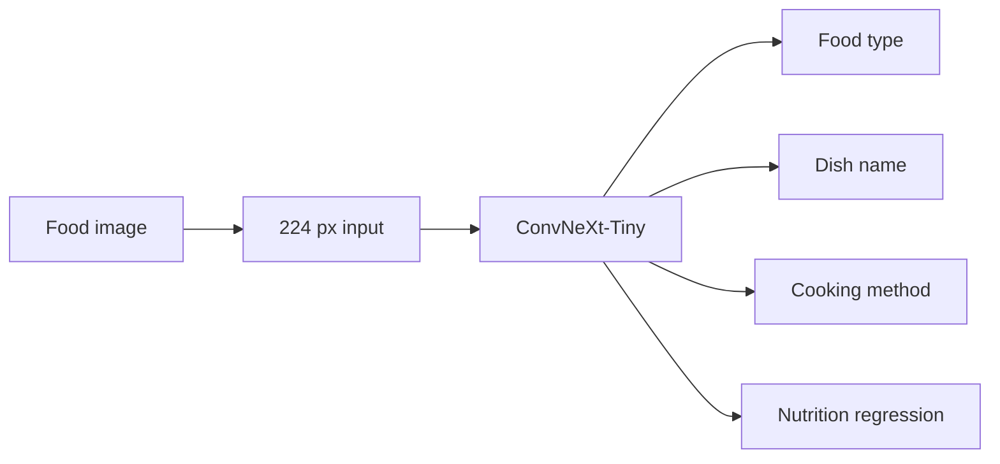

# ConvNeXt-Tiny - MMFood Multihead

An image-only food-understanding experiment: one ConvNeXt-Tiny backbone predicts food type, dish name, cooking method and four nutrition values. The repository follows the complete process from dataset exploration to saved predictions and Hugging Face export.

[](https://huggingface.co/muhammadrafifatihulihsan/convnext-tiny-mmfood-multihead)
[](https://pytorch.org/)
[](notebooks/)

[Bahasa Indonesia](README.id.md) | [Usage](docs/usage.md) | [Results](docs/results.md) | [Architecture](docs/project.md)

## What's inside

- **Shared image encoder, four heads:** 5 food contexts, 50 dish names, 11 cooking methods and 4 nutrition targets.
- **Nine executed notebooks:** configuration, EDA, image download, splitting, training, evaluation, export, publishing and packaging. Original outputs remain visible.
- **Experiment evidence:** training curves, confusion matrix, distribution plots, machine-readable metrics and a new exact-image overlap audit.
- **Downloadable model:** safetensors and all loading files on Hugging Face, with a CPU-tested inference example.

This is a personal non-commercial evaluation release, not a production nutrition service or an open-source license. See [use terms](LICENSE.md) and [upstream rights](THIRD_PARTY_NOTICES.md).

## Download the model

**[Open the model and files on Hugging Face](https://huggingface.co/muhammadrafifatihulihsan/convnext-tiny-mmfood-multihead)**

The weights are approximately **112.3 MB**. Download the complete model snapshot for configuration, labels and custom code. GitHub contains the source, notebooks and reports; dataset CSVs, image caches and training checkpoints are excluded.

```python
from huggingface_hub import snapshot_download
snapshot_download(
    repo_id="muhammadrafifatihulihsan/convnext-tiny-mmfood-multihead",
    local_dir="models/convnext-tiny-mmfood-multihead",
)
```

Follow the [usage guide](docs/usage.md) for tested package versions, a complete image-to-prediction example, offline loading and output interpretation. No training run is needed to try the model.

## Saved results

| Task | Test result | Coverage |
| --- | ---: | --- |
| Food type | 77.92% accuracy | 3,600 images |
| Dish name | 79.21% accuracy | 856 images with a top-50 label |
| Cooking method | 65.50% accuracy | 3,600 images |
| Calories | 95.68 kcal MAE | Baseline 190.06 kcal |
| Protein | 6.28 g MAE | Baseline 14.08 g |
| Fat | 5.23 g MAE | Baseline 10.56 g |
| Carbohydrate | 13.26 g MAE | Baseline 23.47 g |


**Read these as saved experiment results.** Exact-image auditing found **281 test images (7.81%) with training-set matches**, so test independence is not established and scores may be optimistic. Dish accuracy covers only the eligible vocabulary subset. Nutrition labels are estimates, not laboratory measurements. [Full results and audit](docs/results.md).

## How it works



The experiment uses 35,998 downloaded images, split into 28,798 train / 3,600 validation / 3,600 test examples. Nutrition is trained in standardized log1p space; predict() returns kcal and grams. Top-k dish predictions always select from the known vocabulary, without an unknown-dish detector.


The exported image processor differs from the notebook evaluation transform. The documented inference example explicitly follows historical Resize(255), CenterCrop(224) and ImageNet normalization. See [architecture](docs/project.md), [data preparation](docs/data.md) and [preprocessing caveat](docs/results.md#preprocessing-discrepancy).

## Explore the experiment

```text
00 Setup -> 01 EDA -> 02 Image cache -> 03 Splits and labels
         -> 04 Training -> 05 Evaluation -> 06 Export
         -> 07 Hub publication -> 08 Results packaging
```

Browse [the notebook sequence](docs/training.md) to inspect each saved stage. Code, weights and notebook output bytes are preserved; documentation and the audit explain what is actually supported by the experiment. Rerunning training is not necessary for inference and is outside the evaluation-only permission.

## Repository map

```text
notebooks/          Nine executed notebooks
src/                Original data, model and training implementation
artifacts/          Saved experiment configuration and label statistics
docs/               Usage, architecture, data, training and results
reports/metrics/    Historical metrics plus publication overlap audit
reports/figures/    EDA, training and evaluation plots
licenses/           Upstream backbone license text
```

## Documentation

| Read | For |
| --- | --- |
| [Usage](docs/usage.md) / [Indonesia](docs/usage.id.md) | Installation, model download and inference |
| [Project](docs/project.md) | Four heads, loss, decoding and implementation map |
| [Dataset](docs/data.md) | Cleaning, sampling, vocabularies and imbalance |
| [Results](docs/results.md) | Metrics, learning curves, baseline and leakage |
| [Training](docs/training.md) | Original hyperparameters and notebook dependencies |
| [Troubleshooting](docs/troubleshooting.md) | Environment, authentication and loading problems |
| [Publication](docs/publishing.md) | Owner maintenance and artifact integrity |
| [Attribution](docs/attribution.md) | Dataset, backbone, libraries and citation |

[Validation record](VALIDATION.md) distinguishes local inference checks from the six-epoch training run, which was not repeated. [SHA256SUMS.txt](SHA256SUMS.txt) records package contents. Author: [muhammadrafifatihulihsan](https://github.com/muhammadrafifatihulihsan).
