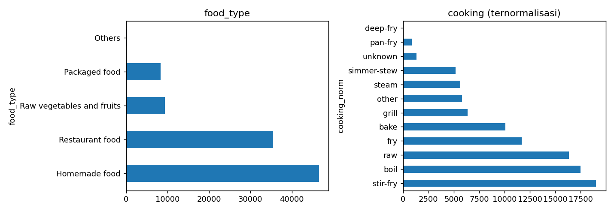
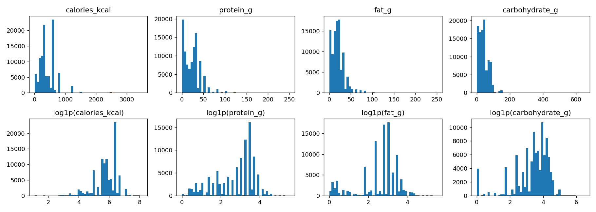

# Dataset and preparation

[Documentation](README.md) | [Results](results.md)

## Source

[MM-Food-100K](https://huggingface.co/datasets/Humanbased-AI/MM-Food-100K), originally Codatta/MM-Food-100K, supplies image URLs and structured annotations. Its card describes human/model-assisted annotation and non-commercial OpenRAIL-M terms. Dataset files are not redistributed. See [attribution](attribution.md).

| Stage | Rows |
| --- | ---: |
| Raw metadata | 100,000 |
| After cleaning | 99,949 |
| Stratified download attempts | 36,000 |
| Downloaded examples | 35,998 |
| Train / validation / test | 28,798 / 3,600 / 3,600 |

The code filters food probability below 0.5, parses four nutrition fields, drops missing nutrition and requires positive calories. These checks do not establish annotation accuracy. Images are converted to RGB JPEG, longest side at most 256 px, quality 90.

## Label design

The raw metadata has 19,288 unique dish names and 2,264 raw cooking labels. Dish names are lowercased and whitespace-normalized; the most frequent 50 in the full cleaned dataset become classes. Other rows receive -100 and are ignored by dish loss. This vocabulary selection precedes the split and uses global frequency information.

There are 22,514 dish-labeled cleaned rows; final train/validation/test labeled counts are 6,464 / 790 / 856. Food-type classes are collected from the sampled data. Cooking labels use ordered regex rules, first match wins. Categories with fewer than 150 train examples merge into `other`; the export has 11 cooking classes including `unknown`.

The `Others` food type has only 77 train and 10 test examples, versus 13,413 train examples for `Homemade food`. Overall accuracy therefore hides substantial class imbalance.

## Nutrition and images

Nutrition targets are log1p-transformed and standardized with train-only statistics. Values describe source annotations for photographed food, not explicitly per 100 g. Ingredients and portion labels are unused. Right-skewed and rounded labels limit what the regressor can learn about real nutrition.

Train transforms: random resized crop to 224 (scale 0.6-1.0), horizontal flip, color jitter, tensor conversion and ImageNet normalization. Evaluation: bilinear resize short side to 255, center crop 224 and the same normalization.

## Split independence

The split is random and stratified by food type, seed 42. URLs do not overlap, but 431 identical cached-image hash groups span splits. Of 3,600 test images, 281 match train bytes. See the [audit JSON](../reports/metrics/publication_audit.json) and [results analysis](results.md). URL uniqueness is not proof of independent images.
