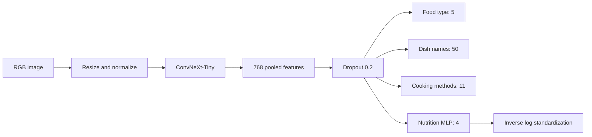

# Project and architecture

[Documentation](README.md) | [Usage](usage.md) | [Results](results.md)

## Research question

Can one compact image encoder support several food-understanding tasks at once? This experiment fine-tunes ConvNeXt-Tiny on a downloaded subset of MM-Food-100K. A shared representation feeds three classification heads and a four-output nutrition regressor. Although the source dataset is multimodal, this model takes images only: ingredients, recipes and measured portions are not inputs.

| Head | Layers | Objective | Output |
| --- | --- | --- | --- |
| Food type | Linear 768 to 5 | Cross entropy | Context such as homemade or restaurant food |
| Dish | Linear 768 to 50 | Cross entropy; ignore -100 | Restricted dish vocabulary |
| Cooking | Linear 768 to 11 | Cross entropy | Normalized cooking methods |
| Nutrition | Linear 768 to 256, GELU, dropout, Linear 256 to 4 | Smooth L1 | Calories, protein, fat, carbohydrate |

Combined loss is `food + dish + 0.5 * cooking + nutrition`. Dish loss is zero for batches without valid dish targets. Nutrition uses `z = (log1p(y) - mean_train) / std_train`. Prediction applies `expm1(clamp(z * std_train + mean_train, max=9))`, clips to nonnegative values and rounds to one decimal place. The clipping is implementation behavior, not a physiological guarantee.

`predict()` returns ranked softmax scores for classification and decoded nutrition. Scores are not calibrated confidence. There is no unknown-dish rejection head. `food_type` refers to food context, not dish identity.

## Implementation map

| File | Responsibility |
| --- | --- |
| `src/config.py` | Configuration, local and Drive paths |
| `src/data_utils.py` | Nutrition parsing and label normalization |
| `src/images.py` | Download, JPEG cache, archive/restore |
| `src/dataset.py` | Dataset, transforms and loaders |
| `src/modeling_mmfood.py` | Custom config, model, heads and decoding |
| `src/train_utils.py` | Model construction and evaluation |

The exported config embeds backbone configuration, so local model construction does not need a second backbone download. The training utility still requests upstream backbone configuration. The custom model is loaded with AutoModel; generic image-classification pipeline compatibility is not promised.

GitHub contains code, executed notebooks and experiment evidence. Hugging Face contains inference artifacts and reports. Neither publishes the dataset, cached images or optimizer checkpoint. This is an experiment and a usable local model, not a hosted API or web application.
