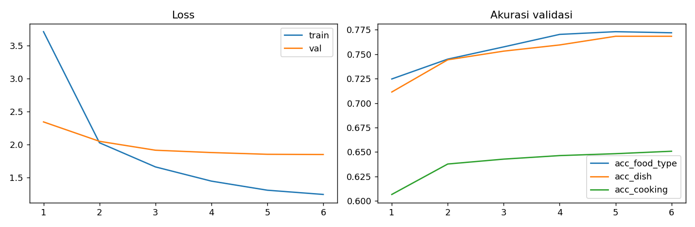
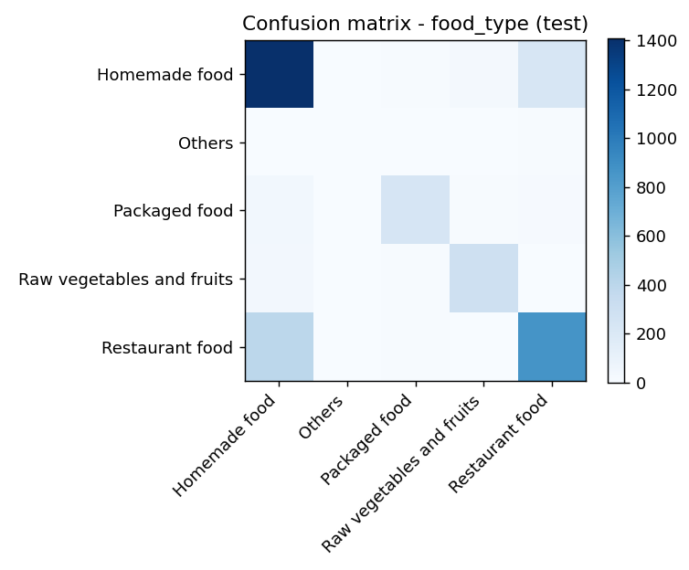

# Hasil dan interpretasi

[Dokumentasi](README.md) | [Data](data.md) | [Validasi](../VALIDATION.md) | [English](results.md)

## Hasil test tersimpan

Ini hasil tercatat dari test_metrics.json, bukan evaluasi baru yang diulang. Checkpoint dipilih berdasarkan loss validasi terendah selama enam epoch tercatat.

| Tugas | Akurasi | Contoh yang dievaluasi |
| --- | ---: | ---: |
| Jenis makanan | 77.92% | 3,600 |
| Hidangan, kosakata top-50 | 79.21% | 856 |
| Metode memasak | 65.50% | 3,600 |

Akurasi hidangan hanya berlaku pada subset berlabel (23.78% test), bukan sembarang foto makanan. Model selalu memberi peringkat hidangan yang dikenal, termasuk ketika hidangan sebenarnya berada di luar kosakatanya.

| Nutrisi | MAE model | MAE baseline | Penurunan MAE relatif |
| --- | ---: | ---: | ---: |
| Kalori (kcal) | 95.68 | 190.06 | 49.66% |
| Protein (g) | 6.28 | 14.08 | 55.42% |
| Lemak (g) | 5.23 | 10.56 | 50.50% |
| Karbohidrat (g) | 13.26 | 23.47 | 43.51% |

Baseline: `expm1(mean(log1p(train_targets)))`, diprediksi untuk setiap gambar test. Ini bukan rata-rata aritmetika dalam satuan asli maupun baseline median yang meminimalkan error absolut. Penurunan error relatif bukan akurasi nutrisi.

## Apakah hasil ini buruk?

Model mempelajari sinyal berguna pada split tercatat, tetapi buktinya belum cukup untuk menyebutnya andal pada foto dunia nyata yang baru. Lebih tepat menyebutnya baseline eksperimen yang terbatas daripada memberi label seluruh proyek sebagai gagal atau berhasil. Belum ada ambang penerimaan per tugas atau benchmark eksternal independen.

Sebagai konteks, perhitungan baru saat publikasi memilih label yang paling sering muncul di train, lalu memprediksi label tersebut untuk setiap gambar test yang memenuhi syarat:

| Tugas | Baseline mayoritas train pada test | Model tercatat | Interpretasi |
| --- | ---: | ---: | --- |
| Jenis makanan | 46.58% (1,677/3,600) | 77.92% | Lebih baik daripada selalu menebak konteks dominan |
| Hidangan, subset berlabel | 10.05% (86/856) | 79.21% | Lebih kuat daripada prediksi konstan dalam kosakata terbatas |
| Metode memasak | 18.28% (658/3,600) | 65.50% | Ada sinyal yang dipelajari, tetapi sekitar sepertiga prediksi yang dievaluasi salah |

Ini baseline kelas konstan, bukan model terlatih pembanding, dan masih memakai split bermasalah yang sama. Angka tersebut tidak membuktikan generalisasi bebas kebocoran. Jumlahnya tersimpan di publication_audit.json; metrik historis model tidak diubah.

Untuk nutrisi, MAE 95.68 kcal berarti rata-rata selisih absolut sekitar 96 kcal dari label dataset. Bukan berarti setiap prediksi berada dalam rentang error 96 kcal, akurasi 95.68%, atau toleransi error klinis. Sebagian error dapat jauh lebih besar; error ekstrem dan per subkelompok belum dilaporkan. MAE lebih rendah dari baseline konstan memberi perbandingan berguna pada split ini, bukan pengukuran porsi yang dapat dipercaya.

## Mengapa performa masih terbatas

| Tugas atau mekanisme | Hal yang diketahui dalam proyek ini | Efek yang masuk akal, bukan atribusi sebab-akibat terukur |
| --- | --- | --- |
| Konteks makanan | Label mencakup makanan rumahan dan restoran; input hanya gambar makanan | Hidangan yang tampak sama dapat dibuat di rumah atau disajikan restoran. Label konteks mungkin membutuhkan informasi di luar crop |
| Kelas minoritas | Others memiliki 77 contoh train dan 10 test; kelas mayoritas mendominasi | Sedikit contoh dapat membatasi pembelajaran dan membuat estimasi kelas kecil tidak stabil; akurasi total dapat menyembunyikannya |
| Cakupan hidangan | Hanya 6,464 gambar train memiliki target hidangan top-50; target hidangan lain diabaikan | Head hidangan mendapat lebih sedikit supervisi langsung dibanding tugas lain; sistem tidak dapat menamai hidangan di luar kosakatanya |
| Supervisi metode memasak | Aturan kata kunci berurutan menyederhanakan deskripsi mentah menjadi 11 label | Proses memasak campuran mungkin tidak cocok dengan satu kelas; makanan rebus, kukus, dan stew dapat tampak mirip |
| Supervisi nutrisi | Target berasal dari anotasi sumber, termasuk estimasi berbantuan model; kolom porsi dan bahan tidak dipakai | Gambar saja tidak mengungkap minyak, bahan tersembunyi, massa, atau resep secara andal. Gambar mirip dapat memiliki target nutrisi berbeda |
| Informasi gambar | Sisi terpanjang cache maksimum 256 piksel; input berupa crop 224 | Tekstur kecil dan bagian makanan dapat hilang. Random crop training tetap memakai target nutrisi gambar utuh sehingga berpotensi tidak cocok dengan crop |
| Optimisasi multi-task | Satu encoder melayani empat head dengan bobot loss tetap | Tugas dapat bersaing memakai fitur bersama atau saling membantu. Belum ada ablation satu tugas atau bobot loss yang membuktikan arah dan besar efeknya |

Bukti pada kolom tengah berasal dari konfigurasi, label, jumlah split, dan kode yang tersimpan. Mekanisme pada kolom terakhir adalah hipotesis mengapa setup ini sulit; belum ada eksperimen yang mengisolasi pengaruhnya satu per satu. Tidak tepat menetapkan persentase error yang disebabkan oleh salah satunya.

## Apa yang dapat dan tidak dapat didiagnosis dari kurva

Enam epoch tercatat, dengan loss validasi masih sedikit membaik di akhir. Ini tidak membuktikan bahwa model memerlukan lebih banyak epoch, bahwa enam epoch adalah masalah utama, atau bahwa backbone lebih besar akan menyelesaikannya. Loss train dan validasi memakai data serta perilaku augmentasi/dropout berbeda, sehingga selisih angkanya bukan uji overfitting terkontrol. Kurva yang mulai mendatar sesuai dengan manfaat tambahan yang mengecil, tetapi kurva saja tidak membuktikan underfitting murni maupun overfitting.

Demikian pula, kebocoran gambar adalah masalah kredibilitas yang dapat menaikkan hasil; bukan penjelasan akurasi rendah. Perbedaan processor dapat menjelaskan perbedaan prediksi notebook dan processor ekspor, tetapi tidak menjelaskan error test historis yang dihitung dengan transformasi notebook. Kedua masalah ini tidak boleh dipakai sebagai alasan umum untuk semua kegagalan.

## Apa yang perlu diinvestigasi terlebih dahulu

Untuk eksperimen baru yang diizinkan penulis, prioritaskan pengukuran andal sebelum memperbesar model: kelompokkan gambar identik/nyaris identik sebelum split; tentukan pilihan label hanya dari train; samakan transformasi evaluasi/inferensi; dan evaluasi pada sumber terpisah. Lalu periksa kesalahan aktual per kelas dan laporkan macro-F1, recall per kelas, cakupan top-k hidangan, error ekstrem nutrisi, serta baseline nutrisi median train.

Setelah itu, perbandingan terkontrol dapat menguji keseimbangan kelas, pembersihan label, crop yang mempertahankan seluruh makanan, bobot loss, model satu tugas, training lebih lama, atau backbone lebih besar. Informasi porsi/bahan yang lebih baik memerlukan desain input/data berbeda. Tidak satu pun perubahan ini diterapkan atau diklaim memperbaiki bobot saat ini.

## Perilaku training

Loss train turun dari 3.709 ke 1.245; loss validasi dari 2.343 ke 1.850. Akurasi hidangan validasi naik dari 71.14% ke 76.84%. Perbaikan validasi pada tahap akhir mengecil sementara loss train terus turun. Epoch 6 memiliki loss validasi tercatat terendah. Tren ini menggambarkan split tersebut, bukan generalisasi independen.

Gambar confusion matrix menunjukkan jumlah, bukan recall ternormalisasi. Prediksi mentah per kelas bukan bagian dari artefak publik; tidak ada nilai precision/recall/F1 baru yang disimpulkan dari warna gambar.

## Audit isi identik

| Pengukuran | Hasil |
| --- | ---: |
| File JPEG cache yang di-hash | 35,998 |
| Nilai SHA-256 berbeda | 33,889 |
| Kelompok hash lintas split | 431 |
| Gambar dalam kelompok lintas split | 1,715 |
| Gambar test dengan kecocokan train | 281 / 3,600 (7.81%) |
| Gambar validasi dengan kecocokan train | 263 / 3,600 (7.31%) |

Seluruh byte JPEG cache di-hash dan dikelompokkan berdasarkan split. Ini membuktikan kebocoran gambar identik meskipun URL terpisah. Gambar nyaris identik, versi yang diubah ukurannya, dan salinan yang dikompresi ulang tidak terdeteksi. Angka sebelumnya berupa 477 kemunculan lintas split yang bergantung urutan penelusuran diganti oleh hitungan independen dari urutan ini.

Overlap dapat menaikkan hasil validasi dan test. Pengaruhnya tidak dapat dikuantifikasi tanpa evaluasi baru yang dikelompokkan/dideduplikasi dan mungkin training ulang. Jangan mengurangi persentase duplikasi dari akurasi untuk membuat skor koreksi. Ini hasil eksperimen tersimpan, bukan benchmark bebas kebocoran.

## Perbedaan preprocessing

Evaluasi memakai Resize(255) bilinear, CenterCrop(224). ConvNextImageProcessor ekspor menentukan bicubic dan crop_pct=0.875 dengan shortest edge 224; jalur resize berbeda. [Panduan penggunaan](usage.id.md) memakai transformasi historis. Artefak processor dipertahankan tanpa perubahan untuk ketertelusuran. Metrik penuh belum dihitung ulang pada kedua jalur selama pekerjaan dokumentasi.

## Kesimpulan yang didukung bukti

Keempat head berjalan dan MAE nutrisi tersimpan mengungguli baseline konstan tercatat. Porsi dunia nyata yang akurat, kepastian terkalibrasi, generalisasi ke masakan yang belum dilihat, ketahanan kelas minoritas, dan kelayakan medis belum terbukti. Versi baru yang diizinkan memerlukan split berdasarkan kelompok gambar, pemilihan kosakata hanya dari train, processing konsisten, dan evaluasi eksternal. Publikasi ini tidak mengubah eksperimen asli secara diam-diam.
