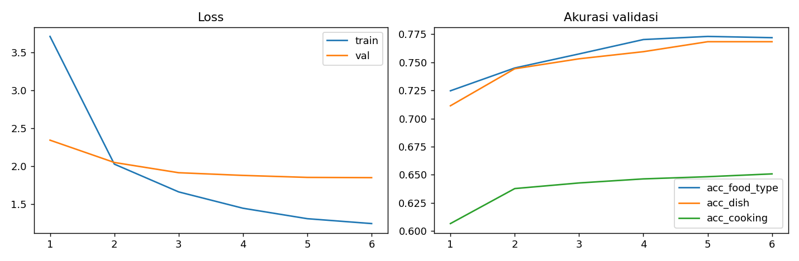
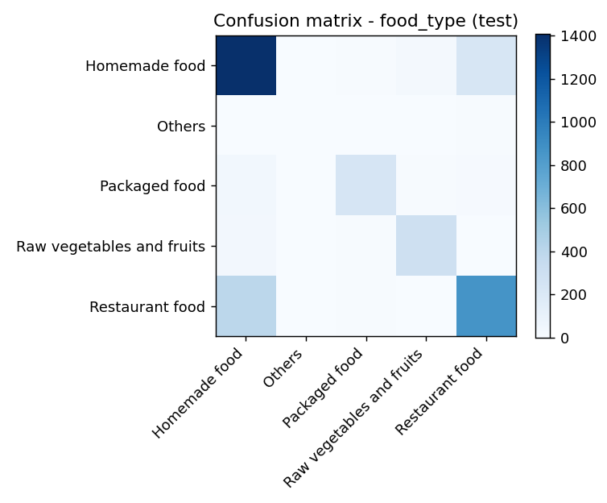

# Results and interpretation

[Documentation](README.md) | [Data](data.md) | [Validation](../VALIDATION.md)

## Saved test results

These are recorded results from test_metrics.json, not a newly repeated evaluation. Checkpoint selection minimizes validation loss over six recorded epochs.

| Task | Accuracy | Evaluated examples |
| --- | ---: | ---: |
| Food type | 77.92% | 3,600 |
| Dish, top-50 vocabulary | 79.21% | 856 |
| Cooking method | 65.50% | 3,600 |

Dish accuracy applies only to the labeled subset (23.78% of test), not arbitrary food photographs. The model always ranks known dishes even when the actual dish is outside its vocabulary.

| Nutrition | Model MAE | Baseline MAE | Relative MAE reduction |
| --- | ---: | ---: | ---: |
| Calories (kcal) | 95.68 | 190.06 | 49.66% |
| Protein (g) | 6.28 | 14.08 | 55.42% |
| Fat (g) | 5.23 | 10.56 | 50.50% |
| Carbohydrate (g) | 13.26 | 23.47 | 43.51% |

Baseline: `expm1(mean(log1p(train_targets)))`, predicted for every test image. It is neither the arithmetic mean in original units nor the median baseline that minimizes absolute error. Relative error reduction is not nutrition accuracy.

## Training behavior

Train loss fell from 3.709 to 1.245; validation loss from 2.343 to 1.850. Validation dish accuracy rose from 71.14% to 76.84%. Later validation improvements were smaller while train loss continued falling. Epoch 6 has the lowest recorded validation loss. These trends describe this split, not independent generalization.

The confusion image shows counts, not normalized recall. Raw per-class predictions are not part of the published artifacts; no new precision/recall/F1 values are inferred from image colors.

## Exact-content audit

| Measurement | Result |
| --- | ---: |
| Cached JPEG files hashed | 35,998 |
| Distinct SHA-256 values | 33,889 |
| Hash groups spanning splits | 431 |
| Images in cross-split groups | 1,715 |
| Test images with train matches | 281 / 3,600 (7.81%) |
| Validation images with train matches | 263 / 3,600 (7.31%) |

Full cached JPEG bytes were hashed and grouped by split. This confirms exact-image leakage despite disjoint URLs. Near duplicates, resized versions and recompressed copies are not detected. The earlier traversal-dependent count of 477 crossing occurrences is replaced by these order-independent counts.

Overlap can inflate validation and test results. Its effect cannot be quantified without a new grouped/deduplicated evaluation and potentially retraining. Do not subtract the duplicate fraction from accuracy to invent a corrected score. These are saved experimental results, not a leakage-free benchmark.

## Preprocessing discrepancy

Evaluation uses bilinear Resize(255), CenterCrop(224). The exported ConvNextImageProcessor specifies bicubic sampling and crop_pct=0.875 with shortest edge 224; its resize path differs. The [usage guide](usage.md) uses the historical transform. The processor artifact is retained unchanged for provenance. Full metrics have not been recomputed for either path during documentation work.

## Conclusions supported by evidence

All four heads run, and saved nutrition MAE beats the recorded constant baseline. Accurate real-world portions, calibrated certainty, unseen-cuisine generalization, minority-class robustness and medical suitability are not established. A future authorized model version would require image-group splitting, train-only vocabulary selection, consistent processing and external evaluation. This publication does not silently change the original experiment.
